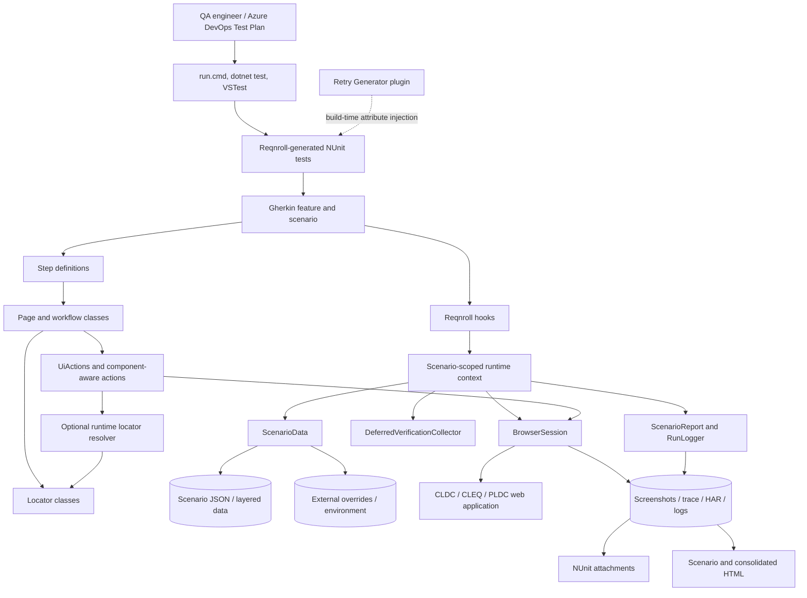
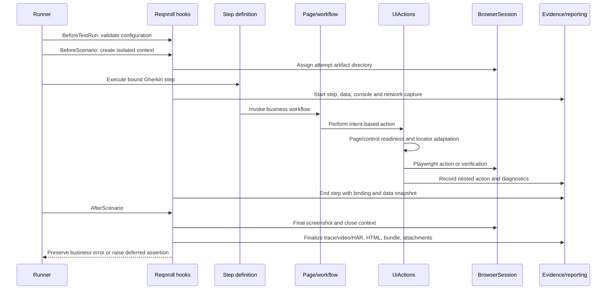
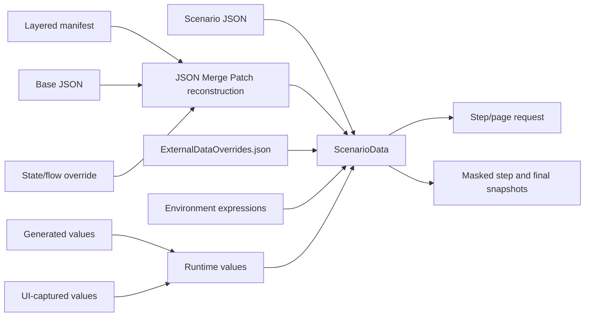
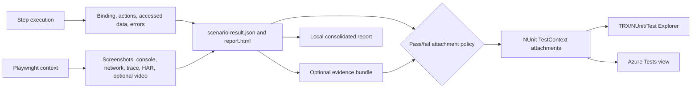
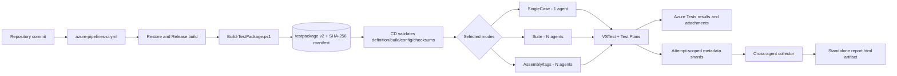

# Enterprise Insurance UI Automation Framework

Production-grade, data-driven browser automation for policy administration and quoting applications. The solution combines **.NET 8**, **C# 12**, **Microsoft Playwright**, **Reqnroll**, and **NUnit** to provide business-readable tests, reusable application workflows, deterministic browser interaction, isolated scenario execution, and audit-ready evidence.

The executable suites cover:

- Commercial Lines Duck Creek (`CLDC`)
- Commercial Lines ExpertQuote (`CLEQ`)
- Personal Lines Duck Creek (`PLDC`)

This document is the framework architecture, operations, and contribution guide. Paths and behaviors described here reflect the implementation in this repository rather than a target-state design.

## Contents

- [Architecture at a glance](#architecture-at-a-glance)
- [Technology stack](#technology-stack)
- [Architectural principles](#architectural-principles)
- [High-level implementation](#high-level-implementation)
- [Solution and folder structure](#solution-and-folder-structure)
- [Scenario execution lifecycle](#scenario-execution-lifecycle)
- [Test authoring model](#test-authoring-model)
- [Configuration, data, and secrets](#configuration-data-and-secrets)
- [Local setup and execution](#local-setup-and-execution)
- [Retries, evidence, and reporting](#retries-evidence-and-reporting)
- [Azure DevOps delivery architecture](#azure-devops-delivery-architecture)
- [Quality gates and contribution rules](#quality-gates-and-contribution-rules)

## Architecture at a glance

The framework uses a layered test architecture. Business scenarios remain in Gherkin; application projects own bindings, workflows, pages, and locators; shared libraries own execution mechanics and NUnit integration. A browser context and all mutable runtime services are created per scenario, which prevents browser, data, and evidence leakage between parallel tests.

| Layer | Primary responsibility | Implemented in |
| --- | --- | --- |
| Business specification | Executable behavior, examples, application/LOB/suite tags | `tests/*/Features` |
| Binding and workflow | Translate business steps into application workflows and data decisions | `tests/*/StepDefinitions` |
| Application abstraction | Page-level business operations and source-backed control identity | `tests/*/Pages`, `tests/*/Pages/Locators` |
| Application runtime adaptation | App-specific frame and runtime locator resolution where required | `tests/CommercialLines.DuckCreek.Tests/Runtime` |
| Shared automation services | Browser lifecycle, UI actions, waits, scenario data, logging, reports, safe paths | `src/InsuranceAutomation.Core` |
| Test-runner integration | Configured retries, attempt context, evidence staging, NUnit attachments | `src/InsuranceAutomation.NUnit` |
| Build-time generation | Inject the configured retry attribute into generated Reqnroll scenario tests | `src/InsuranceAutomation.Retry.Generator` |
| Orchestration | Setup, execution, packaging, report generation, quality gates | `scripts`, `tools`, Azure YAML |

### Quality attributes built into the design

- **Isolation:** one Playwright browser context, scenario data store, report, logger, and evidence directory per scenario attempt.
- **Determinism:** bounded waits, component-aware selection, unique-locator checks, and no arbitrary dropdown selection.
- **Diagnosability:** step/action traces, selected binding identity, data snapshots, console/network errors, screenshots, traces, HAR, and retry history.
- **Maintainability:** shared mechanics in `src`; application-specific business behavior remains inside its test project.
- **Scalability:** NUnit child-test parallelism and Azure VSTest test-case slicing across up to eight agents.
- **Security:** credentials remain outside source control; sensitive report values are masked; file and output paths are constrained to owned repository/package locations.
- **Reproducibility:** CI builds an immutable, checksummed test package that CD executes without source checkout.

## Technology stack

Versions below are the versions currently pinned in project and repository configuration. The project files and `global.json` remain authoritative.

| Concern | Technology | Current version/configuration | Role |
| --- | --- | --- | --- |
| Runtime | .NET | SDK `8.0.423`, `latestPatch`; application projects target `net8.0` | Build and execution platform |
| Language | C# | `12.0`, nullable and implicit usings enabled | Framework and tests |
| Browser automation | Microsoft Playwright for .NET | `1.61.0` | Chromium/Edge automation, contexts, screenshots, video, traces, HAR |
| BDD | Reqnroll.NUnit | `3.3.4` | Gherkin parsing, bindings, test generation, NUnit integration |
| Test framework | NUnit | `4.6.1` | Assertions, lifecycle, parallel execution, attachments |
| Test adapter | NUnit3TestAdapter | `6.0.0` | Visual Studio, `dotnet test`, and VSTest discovery/execution |
| Test host | Microsoft.NET.Test.Sdk | `17.14.1` | Test-host infrastructure |
| Build-time plugin | Reqnroll.Tools.MsBuild.Generation | `3.3.4`; generator targets `netstandard2.0` | Retry-attribute injection into generated scenarios |
| Local orchestration | PowerShell/cmd | PowerShell 7+ recommended | Setup, execution, packaging, output ownership |
| Report/quality tooling | Python | Python 3.x locally; `3.11` in YAML CD | Consolidation, release metadata, repository checks |
| CI/CD | Azure Pipelines and VSTest | Windows agents | Immutable package build, sharded execution, Test Plans, result publishing |

### Shared build and concurrency policy

`Directory.Build.props` centralizes C# settings, output paths, run settings, Reqnroll intermediate generation, and shared assembly parallelization. `Directory.Build.targets` builds one host-specific retry-generator plugin per application test project before Reqnroll code generation. `Tosca.runsettings` and `Parallelization.cs` currently configure three test workers/CPUs and child-test parallelism. Capacity is therefore controlled at two levels: workers inside an agent and VSTest slices across CD agents.

## Architectural principles

1. **Business specifications do not drive Playwright directly.** Feature steps bind to step definitions, which call pages/workflows, which use `UiActions` and locators.
2. **Control identity and control behavior are separate.** Locator classes identify controls; `UiActions` and `ComponentAwareControlActions` implement interaction semantics.
3. **Application variation stays at the application boundary.** CLDC runtime frame/locator adaptation is injected through `IRuntimeLocatorResolver`; shared core code is not coupled to Duck Creek page classes.
4. **Scenario state is explicit.** `ScenarioData` owns source, external, generated, and captured values. Reqnroll `ScenarioContext` owns scenario-scoped services.
5. **Verification diagnostics precede final failure.** Eligible UI verification failures can be collected, evidenced, and converted to the final NUnit failure during teardown; navigation and action failures remain immediately fatal.
6. **Retries are runner-level attempts, not hidden action loops.** A failed scenario repeats setup and teardown with a fresh scenario/browser context, preserving each attempt independently.
7. **Artifacts are outputs, never source.** Runtime results are written only to an owned, locked results root and must not be referenced by test source.

## High-level implementation

### Logical framework architecture



### Runtime request path



### Scenario-scoped dependency model

Each application project's `Hooks/TestHooks.cs` performs the composition-root role. It loads `FrameworkConfig` once per test run and creates these services for every scenario attempt:

- a unique artifact directory and `NUnitTestEvidenceContext`;
- `RunLogger` and `ScenarioReport`;
- `BrowserSession`;
- `ScenarioData`;
- `DeferredVerificationCollector`;
- application-configured `UiActions`;
- the CLDC `DuckCreekRuntimeLocatorResolver` where applicable.

These objects are stored in Reqnroll `ScenarioContext`. Do not introduce static browser, page, test-data, or report state: it breaks parallel isolation and retry evidence.

## Solution and folder structure

```text
PnC_DC_TestAutomation/
|-- config/                         Runtime framework configuration
|-- docs/                           Reserved long-form design/operations documentation
|-- pipelines/templates/            Reusable Azure YAML execution and collection jobs
|-- scripts/                        PowerShell setup, run, package, and report orchestration
|-- src/                            Shared framework libraries
|   |-- InsuranceAutomation.Core/
|   |-- InsuranceAutomation.NUnit/
|   `-- InsuranceAutomation.Retry.Generator/
|-- tests/                          Application-owned executable suites
|   |-- CommercialLines.DuckCreek.Tests/
|   |-- CommercialLines.ExpertQuote.Tests/
|   `-- PersonalLines.DuckCreek.Tests/
|-- tools/                          Python quality, data-maintenance, and report utilities
|-- TestResults/                    Generated local output; never source-controlled
|-- azure-pipelines-ci.yml          Immutable package build
|-- azure-pipelines-cd.yml          Multi-mode test execution and consolidation
|-- Directory.Build.props           Shared build/output/language policy
|-- Directory.Build.targets         Retry-generator integration
|-- global.json                     .NET SDK selection
|-- Parallelization.cs              Shared NUnit assembly parallelization
|-- reqnroll.json                   Reqnroll generator policy
|-- Tosca.runsettings               Local/test-host concurrency and output settings
|-- setup.cmd / run.cmd             Stable Windows entry points
`-- ToscaCanonicalSimple.sln        Solution boundary
```

### Folder significance

| Path | Significance and ownership |
| --- | --- |
| `config` | Single runtime configuration contract for browser, reporting, execution, and waits. Override its location with `TEST_FRAMEWORK_CONFIG`; do not create per-developer committed copies. |
| `src/InsuranceAutomation.Core` | Application-neutral runtime: Playwright session lifecycle, intent-driven UI actions, component-aware controls, data resolution, safe file access, logging, reports, output paths, and deferred verification. Changes affect every suite. |
| `src/InsuranceAutomation.NUnit` | NUnit boundary: configured retry command, attempt tracking, evidence finalization/staging, attachment policy, and result-context identity. It must remain free of application-specific page behavior. |
| `src/InsuranceAutomation.Retry.Generator` | Build-time Reqnroll plugin. It adds `ConfiguredRetryAttribute` to generated scenario methods. Host-specific output/assembly names prevent generator load collisions between test projects. |
| `tests/CommercialLines.DuckCreek.Tests` | CLDC specifications and implementation, including Duck Creek `fieldref`, frame hints, and runtime locator stabilization. |
| `tests/CommercialLines.ExpertQuote.Tests` | CLEQ specifications and implementation, assets, and Angular/stable-contract locator strategy. |
| `tests/PersonalLines.DuckCreek.Tests` | PLDC specifications and implementation using shared core services and its application pages/data. |
| `scripts` | Supported PowerShell operations. `setup.ps1` restores/builds/installs Chromium; `run.ps1` executes projects and consolidates results; package/release scripts enforce immutable artifact checks and safe output roots. |
| `tools` | Offline Python tooling for quality gates, Basic/PLDC data contracts, report generation, release metadata transport, and regression tests. These tools do not replace compilation or browser tests. |
| `pipelines/templates` | YAML jobs for exact CI-package download, VSTest execution, evidence shard publication, and cross-agent report collection. |
| `.azuredevops` | Supporting Azure DevOps scripts/assets used by pipeline or classic-release integration. |
| `TestResults` | Generated, lock-protected local results. The runner only cleans a folder carrying its ownership marker and rejects unsafe/reparse-point paths. |
| `bin` / `obj` | Generated build outputs. Repository-wide `BaseOutputPath` places compiled output under root `bin/<Project>/<Configuration>/...`; never edit or commit these files. |

### Application test-project anatomy

Each application project follows the same separation of concerns:

```text
<Application>.Tests/
|-- Features/
|   |-- Basic/                      Basic suites where applicable
|   `-- Smoke/                      Smoke suites
|-- Hooks/                          Reqnroll lifecycle/composition root
|-- StepDefinitions/                Business-step bindings and workflow decisions
|-- Pages/                          Reusable application operations
|   `-- Locators/                   Control identity only
|-- Runtime/                        Optional application runtime adapters (CLDC)
`-- TestData/
	|-- Scenarios/Basic/            Standalone cleaned Basic data where applicable
	|-- Scenarios/Smoke/            Scenario source data
	|-- Layered/                    Manifest/base/override data for opted-in flows
	|-- Assets/                     Upload/input assets where required (CLEQ)
	`-- ExternalDataOverrides.json  Optional non-secret external value overrides
```

`Runtime` and `Assets` are optional and exist only where required. PLDC currently has Smoke features but no Basic feature category.

## Scenario execution lifecycle

1. **Discovery and generation:** Reqnroll converts `.feature` scenarios into NUnit tests. The build target supplies the retry generator, which decorates generated scenario methods.
2. **Configuration validation:** `BeforeTestRun` loads and validates `config/framework.json`, including browser choice, positive timeouts, retry range, attachment mode, and output roots.
3. **Attempt initialization:** NUnit creates a retry attempt context. `BeforeScenario` creates a unique artifact directory and all scenario-scoped services.
4. **Data loading:** the application step resolves a scenario JSON path and external override path; `ScenarioData` safely loads direct or manifest-backed data.
5. **Browser startup:** the feature's browser step opens Edge by configured channel or the configured Playwright fallback, then creates a fresh browser context/page.
6. **Step execution:** hooks reset step evidence and data access tracking. The selected binding invokes page workflows and `UiActions`.
7. **Interaction processing:** actions perform bounded readiness, optional highlighting, runtime locator adaptation, component-specific behavior, and Playwright execution.
8. **Step reporting:** hooks record pass/fail state, selected binding method, accessed data, nested actions, screenshot, console errors, and network errors.
9. **Scenario finalization:** the framework captures the final screenshot, closes the browser context to finalize trace/video/HAR, writes reports/bundles, and publishes allowed NUnit attachments.
10. **Outcome and retry:** fatal errors retain their original exception. Deferred UI verification failures become a final assertion after evidence publication. If eligible and configured, NUnit starts a completely new attempt.

## Test authoring model

### Feature and tag conventions

Feature files are business-readable contracts and should not contain browser implementation detail. Categories support VSTest filtering and pipeline selection.

- Application: `@CLDC`, `@CL_EQ`, or the applicable PLDC application tag.
- Product/LOB: for example `@BAP`, `@SFP`, `@AUTO`.
- Suite: `@basic` or `@smoke_test`.
- LOB plus suite: for example `@bap_basic`, `@cp_smoke_test`.
- Application plus suite: `@cldc_basic`, `@cleq_basic`, `@cldc_smoke_test`.
- Business capability tags may be added after the application/LOB/suite tags.

For Basic features, keep all five selection dimensions when applicable: application, LOB, `basic`, `<lob>_basic`, and `<application>_basic`. Reqnroll exposes these tags as NUnit/VSTest `TestCategory` values.

### Responsibilities by test layer

- **Features:** intent, examples, and acceptance behavior.
- **Step definitions:** binding text, scenario data access, branching, generated/captured runtime values, and orchestration across pages.
- **Pages/workflows:** reusable business interactions and navigation sequences.
- **Locators:** stable, source-backed selectors only; no workflow logic.
- **`UiActions`:** synchronization, interaction semantics, action tracing, verification behavior, and highlighting.

### Locator strategy

Prefer contracts in this order: source-backed technical attributes, stable IDs/names/test IDs, associated labels/ARIA roles, and exact action text. A locator must resolve to one intended visible control; never use an arbitrary `First`/index merely to suppress ambiguity.

CLDC data controls commonly map literal Duck Creek IDs to rendered `fieldref` selectors. Repeated `fieldref` values must be disambiguated with an exact source label relationship. Raw frame metadata is only a hint: `DuckCreekFrameScopeResolver` probes the hinted frame briefly, falls back to the top document, and caches successful scenario-local scope. `DuckCreekRuntimeLocatorResolver` can derive a unique stable recipe from a successfully resolved seed and records its decisions in `runtime-locators.jsonl`.

CLEQ locators do not use Duck Creek `fieldref`/`duckcreekid` selectors. Use source-backed Angular/stable contracts such as `data-testid`, stable `id`/`name`, ARIA roles, labels, and exact action text. PLDC follows its own pages while sharing the same core interaction model.

### Dropdown and component behavior

`ComponentAwareControlActions` centralizes native selects, Angular Material controls, autocomplete inputs, checkboxes, radios, toggles, tabs, dialogs, panels, and grids. Dropdown choice is deterministic:

1. exact visible option;
2. unique controlled partial option;
3. controlled Enter commit only when semantically safe.

Native selects never guess an option, and Tab is not used to walk dropdown values. Overlay cleanup and bounded option polling handle transient Angular panels without unbounded sleeps.

### Waits and verifications

Use `UiActions`; do not scatter fixed sleeps through pages or steps. The action pipeline can wait for DOM readiness, overlays, attachment/visibility/actionability, and application control state. A best-effort readiness timeout is diagnostic; the subsequent Playwright action remains authoritative.

Verification supports equality and generated operator prefixes such as `Regex:value`, `Regex:InnerText`, `NotEqual:Value`, and `NotEqual:InnerText`. When `execution.deferVerificationFailures` is enabled, eligible exhausted UI verifications are collected so the scenario can expose additional failures. Browser/navigation/action failures are never softened.

## Configuration, data, and secrets

### Runtime configuration

`config/framework.json` has four sections:

| Section | Controls |
| --- | --- |
| `browser` | Edge channel/Playwright fallback, headed/headless mode, viewport/maximize, HTTPS handling, action/navigation timeouts, trace/video/HAR, screenshots, highlighting |
| `reporting` | Results/artifact roots, HTML/data/error inclusion, evidence bundle and attachment policy, pass/fail evidence policy, video retention, attachment guardrails |
| `execution` | Scenario retry count, unknown-condition strictness, external-data file, deferred verification behavior |
| `waits` | Page/control/verification/frame/dropdown time budgets and polling behavior |

Select another configuration file before execution with:

```powershell
$env:TEST_FRAMEWORK_CONFIG = "C:\path\framework.json"
```

The loader constrains the configuration to the repository/package root. The runner also sets `TEST_RESULTS_ROOT` and `TEST_REPOSITORY_ROOT` for a run and restores previous values afterward.

### Scenario-data architecture



Lookup precedence for a normal key is **runtime value → non-synthetic external override → static scenario value → canonical compatibility value → supplied fallback**. Required lookups reject empty or `SYNTHETIC_REPLACE_ME` values. Expression resolution supports data/runtime/external/environment placeholders, Tosca buffer aliases, and bounded source-function evaluation. Sensitive keys are masked in report snapshots.

Basic scenario JSON under `TestData/Scenarios/Basic` is standalone authoritative runtime data. Historical `_canonical` and `_rawTosca` payloads have been removed; aliases still required by bindings are promoted into `values`. Basic scenarios do not route through layered manifests. Validate this contract with `python .\tools\basic_scenario_data.py`; use `--apply` only for an intentional scoped cleanup.

Flows that retain `TestData/Layered/manifest.json` entries are reconstructed from base and override documents with JSON Merge Patch semantics. The package gate verifies that reconstructed JSON exactly matches the scenario source. Standalone data—including cleaned Basic and applicable PLDC Smoke scenarios—loads directly.

### Credentials

Never commit credentials or place them in scenario JSON. Use local environment variables or secret CI/CD variables:

```powershell
$env:CL_DC_USERNAME = ""
$env:CL_DC_PASSWORD = ""
$env:CL_EQ_USERNAME = ""
$env:CL_EQ_PASSWORD = ""
$env:PL_DC_USERNAME = ""
$env:PL_DC_PASSWORD = ""
$env:CL_DC_UW_DIRECTOR_USERNAME = ""
$env:CL_DC_UW_DIRECTOR_PASSWORD = ""
```

`credentials.example.ps1` is an empty template. The UW Director variables are required only by CLDC flows using that role.

## Local setup and execution

### Prerequisites

- Windows 10/11 or Windows Server agent
- .NET 8 SDK (`global.json` selects SDK `8.0.423` with latest-patch roll-forward)
- PowerShell 7+ recommended; cmd entry points are supplied
- Microsoft Edge and/or Playwright Chromium
- Python 3.x for report generation and repository quality tooling
- Azure DevOps Test Plans access only for Test Plan execution modes

### First-time setup

From the repository root:

```powershell
.\setup.cmd
```

The setup command restores the solution, builds Debug output, locates the generated Playwright installer, and installs Chromium. Configure `config/framework.json` and credential environment variables before executing application tests.

### Supported runner

Use `run.cmd` for normal local execution. It applies repository run settings, initializes a safe owned results directory, sets the runtime root variables, executes selected projects, retains nonzero test status, and attempts consolidated-report generation even when tests fail.

```powershell
# All application suites
.\run.cmd -Project ALL

# One application suite
.\run.cmd -Project CLDC
.\run.cmd -Project CLEQ
.\run.cmd -Project PLDC

# Build configuration
.\run.cmd -Project CLDC -Configuration Debug
.\run.cmd -Project CLDC -Configuration Release

# Smoke or Basic selection
.\run.cmd -Project ALL -Filter "TestCategory=smoke_test"
.\run.cmd -Project CLDC -Filter "TestCategory=basic"

# Application/LOB compound selection
.\run.cmd -Project CLDC -Filter "TestCategory=smoke_test&TestCategory=cp_smoke_test"
.\run.cmd -Project CLDC -Filter "TestCategory=basic&TestCategory=bap_basic"
.\run.cmd -Project CLEQ -Filter "TestCategory=basic&TestCategory=cleq_basic"
.\run.cmd -Project PLDC -Filter "TestCategory=smoke_test&TestCategory=cycle_smoke_test"

# Product/LOB selection
.\run.cmd -Project CLDC -Filter "TestCategory=BAP"
.\run.cmd -Project CLEQ -Filter "TestCategory=SFP"
.\run.cmd -Project PLDC -Filter "TestCategory=AUTO"

# Explicit output root (must remain inside the repository/package root)
.\run.cmd -Project ALL -ResultsDirectory "TestResults"
.\run.cmd -Project CLDC -ResultsDirectory "ClientA_Run_2026_09_11"
```

VSTest filter `&` means AND. Quote compound expressions in PowerShell/cmd as shown.

### Direct `dotnet test` execution

Use this only when deliberately bypassing `run.cmd` output initialization and automatic consolidation:

```powershell
dotnet test .\tests\CommercialLines.DuckCreek.Tests\CommercialLines.DuckCreek.Tests.csproj -c Debug --settings .\Tosca.runsettings --filter "TestCategory=smoke_test"
dotnet test .\tests\CommercialLines.ExpertQuote.Tests\CommercialLines.ExpertQuote.Tests.csproj -c Release --settings .\Tosca.runsettings --filter "TestCategory=smoke_test"
dotnet test .\tests\PersonalLines.DuckCreek.Tests\PersonalLines.DuckCreek.Tests.csproj -c Release --settings .\Tosca.runsettings --filter "TestCategory=smoke_test"
```

### Local output contract

| Output | Location |
| --- | --- |
| Results root | `TestResults` or `-ResultsDirectory` override |
| TRX | `<ResultsRoot>\CLDC.trx`, `CLEQ.trx`, `PLDC.trx` |
| NUnit XML/work | `<ResultsRoot>\NUnit`, `<ResultsRoot>\NUnitWork\<Project>` |
| Scenario evidence | `<ResultsRoot>\Artifacts\<Assembly>\<Feature>\<Scenario_timestamp_guid>` |
| Consolidated report | `<ResultsRoot>\ConsolidatedReport\report.html` |
| Consolidated support output | `log.html`, `output.xml`, `summary.json` in the same folder |

The runner creates `.automation-results` and holds `.automation-run.lock`. It refuses to clear a nonempty unowned folder, a source/configuration folder, a path outside the repository/package, or a path containing reparse points. Do not delete or reuse an active results root.

To regenerate a local report for the same results root:

```powershell
powershell -NoProfile -ExecutionPolicy Bypass -File .\scripts\Generate-ConsolidatedReport.ps1 -ResultsDirectory "TestResults"
```

The generator requires completed `scenario-result.json` evidence and Python. It will not replace existing evidence with an empty report.

## Retries, evidence, and reporting

### Configured scenario retries

Set `execution.retryCount` in the selected framework configuration:

- `0` (default): one attempt;
- `1`: one retry, maximum two attempts;
- `2`: two retries, maximum three attempts.

The Reqnroll generator plugin adds `ConfiguredRetryAttribute` to generated scenario tests. The NUnit wrapper retries only a failed scenario while execution is still active. Passing, skipped, and canceled outcomes are not retried; feature/assembly initialization failures are outside this scope. `WCBasicPolicyFeature` is explicitly excluded in both generation and runtime retry policy.

Every retry repeats scenario setup and teardown with fresh browser/scenario state and a separate evidence folder. It does **not** roll back application-side transactions, so enable retries only for safely repeatable workflows. The final attempt determines the logical result; earlier failures remain visible in the report.

Offline retry/report regression checks:

```powershell
dotnet test .\tools\InsuranceAutomation.Retry.Tests\InsuranceAutomation.Retry.Tests.csproj
python -B -m unittest discover -s tools -p test_retry_report.py -v
```

### Evidence lifecycle



At scenario end, the browser context closes before publication so trace, video, and HAR files are complete. The framework then writes the scenario report, optionally creates an evidence bundle, stages policy-approved files into the NUnit result directory, verifies readability/size/count limits, and calls `TestContext.AddTestAttachment`.

The framework can capture:

- per-step and final screenshots;
- nested `UiActions` method/operation traces;
- the fully qualified Reqnroll binding selected at runtime;
- step-local and final resolved-data snapshots with sensitive values masked;
- execution logs and deferred verification details;
- browser console/page errors and request/response/failure diagnostics;
- Playwright trace, HAR, and optional video;
- CLDC runtime locator decisions;
- standalone scenario HTML, machine-readable scenario result, and optional bundle.

`reporting.passed` and `reporting.failed` independently select evidence categories. `attachmentMode` can be `all` or `key`; maximum attachment size/count are guardrails. `reporting.excludeVideos` takes precedence over every video attachment switch. If global exclusion is false but `excludePassedVideos` is true, recording may begin before outcome is known and successful-attempt videos are removed at finalization; failed-attempt video can be retained.

In HTML reports, expand a step to see its selected C# binding, accessed data, nested actions, error, console/network diagnostics, and screenshot links. Attempt buttons switch complete attempt histories. Runtime captures belong to the final resolved snapshot; only keys read/written during a step appear in that step's snapshot.

### Browser lifecycle

A browser is opened only when the feature invokes the browser-session step. The configured Edge channel is attempted with a Playwright fallback browser. Each scenario receives a new browser context/page, configured default timeouts, optional trace/HAR/video, and console/network listeners. Headed execution can use a no-viewport maximized window; otherwise the configured viewport is used. Context closure and disposal happen during scenario teardown even when the scenario fails.

## Azure DevOps delivery architecture

CI and execution are intentionally separated. CI compiles and signs the execution inputs through a manifest; CD consumes one explicitly selected successful CI artifact and does not build from a moving branch.



### CI: build the immutable test package

`azure-pipelines-ci.yml` triggers for `main` and `sgs/develop` pushes/PRs. It:

1. checks out a clean repository;
2. installs .NET 8;
3. restores and builds the solution in Release;
4. validates required compiled test/runtime files;
5. packages root `bin`, test data, report binding sources, framework configuration, and release/report scripts;
6. writes `package-info.json` schema version 2 with build identity, required files, and SHA-256 hashes for runtime scripts/config;
7. publishes the `testpackage` Build Artifact.

CI does not execute browser tests. Any source/runtime change requires a new CI build before release execution.

### CD: execute selected modes

`azure-pipelines-cd.yml` accepts an exact `buildPipelineDefinitionId` and `ciBuildId`; “latest” selection is deliberately disallowed. The build must be completed, successful, and owned by the selected definition. At least one mode must be selected:

| Mode | Selection mechanism | Agents |
| --- | --- | --- |
| `SingleCase` | Temporary static suite containing one Azure Test Plan case | Exactly 1 |
| `Suite` | Azure Test Plan, suite, and test configuration | `agentCount` |
| `Assembly` | Compiled `*Tests.dll` plus optional VSTest filter | `agentCount` |

`agentCount` supports 1–8 slices. Each execution job uses `checkout: none`, downloads the exact package, verifies manifest checksums, creates an isolated package/results root, rewrites runtime headless/results settings, generates runsettings, installs the selected Playwright browser, and executes VSTest with test-case distribution. VSTest reruns are disabled because framework retries own attempt semantics.

Use Microsoft-hosted `windows-latest` with the default pool or pass a Windows self-hosted pool. Self-hosted agents need network/tool access for .NET, Python 3.11, the VSTest platform, Playwright browser installation, and sufficient parallel-job capacity. Store application credentials as secret variables.

### Pipeline evidence transport

VSTest publishes results and individual attachments to the Azure Tests view. Separately, every agent packages report **metadata only** and uploads an attempt-scoped pipeline artifact before its temporary workspace can be cleaned. The collector downloads all expected shards, rejects missing/duplicate/stale/corrupt evidence, and publishes one self-contained `report.html` artifact.

The portable release report includes scenario identity, outcome, timing, retries, step/data/action/error details, deferred verifications, and capped failed-attempt log excerpts. It deliberately excludes screenshots, video, traces, HAR, evidence ZIPs, and raw TRX/NUnit files. This keeps cross-agent consolidation bounded; full per-test evidence remains in Azure test attachments. Rerun the whole YAML stage rather than selected failed shard jobs because artifact names are immutable and attempt-scoped.

`azure_pipelines_release_pipeline.json` supports Classic Release integration but is not automatically synchronized into Azure DevOps definitions. Classic collectors use Release task attachments/API access rather than YAML named pipeline artifacts and require OAuth permission to view releases.

## Quality gates and contribution rules

### Required validation

Run the repository gate before committing or packaging:

```powershell
python .\tools\package_gate.py
```

The gate checks repository syntax and structure, active feature/step bindings, feature/data references, layered-data reconstruction, Basic and PLDC data contracts, locator restrictions/references, protected assets, reporting, and package cleanliness. It is an offline structural gate; compilation and tests remain authoritative.

For framework or test-code changes, also run:

```powershell
dotnet restore .\ToscaCanonicalSimple.sln
dotnet build .\ToscaCanonicalSimple.sln -c Release --no-restore
dotnet test .\tools\InsuranceAutomation.Retry.Tests\InsuranceAutomation.Retry.Tests.csproj -c Release
python -B -m unittest discover -s tools -p "test_*.py" -v
```

Run the smallest relevant application browser filter when credentials/environment are available. Never claim an end-to-end UI validation from offline gates alone.

### Adding a scenario

1. Place the `.feature` file in the correct application and `Features/Basic` or `Features/Smoke` category.
2. Apply application, LOB, suite, LOB-suite, and application-suite tags consistently.
3. Add or reuse bindings in `StepDefinitions`; avoid duplicate expressions.
4. Add reusable business behavior to a page and stable control identity to its locator class.
5. Add matching JSON under `TestData/Scenarios/<Category>` and assets only when required.
6. Add a layered manifest entry only when the scenario intentionally uses base/override reconstruction; Basic data must remain standalone.
7. Validate the data and package gate, compile, run focused tests, and inspect the generated scenario evidence.

### Adding an application suite

A new suite should reference `InsuranceAutomation.Core` and `InsuranceAutomation.NUnit`, include Reqnroll/NUnit/test SDK packages, copy test data and linked framework configuration to output, and implement hooks that construct the same scenario-scoped service set. Add its project dispatch to `scripts/run.ps1`, package requirements to `Build-TestPackage.ps1`, CI/CD assembly selection as needed, and quality-gate coverage. Keep application-specific locator/runtime behavior in the test project behind shared interfaces.

### Change boundaries

- Change `src/InsuranceAutomation.Core` only for behavior truly shared by applications.
- Keep selectors out of step definitions and workflow logic out of locator classes.
- Keep credentials, generated `bin`/`obj`, and `TestResults` out of source control.
- Do not reference generated outputs from source projects.
- Prefer bounded readiness and semantic component actions over sleeps or force-click workarounds.
- Preserve per-scenario isolation and evidence finalization when adding hooks.
- Update this README when stack versions, configuration contracts, execution paths, output schemas, or pipeline behavior change.

## Troubleshooting

| Symptom | Action |
| --- | --- |
| Credentials missing/login fails immediately | Set the relevant `CL_DC_*`, `CL_EQ_*`, or `PL_DC_*` variables; verify secret-variable scope in pipelines. |
| Browser executable/runtime missing | Run `.\setup.cmd` locally. In CD, verify Playwright download access and package integrity. |
| Edge channel unavailable | Ensure Edge is installed or configure the Playwright fallback browser. |
| Results-root refusal | Choose an empty folder under the repository/package root; do not use source/config folders, symlinks/reparse points, or unowned nonempty directories. |
| Results lock error | Another run/report process owns the same root. Wait for it or select another `-ResultsDirectory`. |
| No consolidated report | Use the same results root as execution; verify Python and at least one `scenario-result.json`. |
| Tests appear capped per agent | Concurrency is currently three in `Tosca.runsettings` and `Parallelization.cs`; CD `agentCount` controls additional cross-agent slices. |
| Dropdown value is not selected | Verify the requested value exists and is exact or uniquely partial; the framework intentionally refuses ambiguous options. |
| Locator ambiguity | Replace positional selection with a stable unique contract or exact label relationship. Review CLDC `runtime-locators.jsonl` where applicable. |
| Retry repeats a business transaction | Set `execution.retryCount` to `0` for non-idempotent scenarios or redesign test setup/data. Retries do not roll back the application. |
| Missing pipeline shard | Inspect the execution job and its evidence upload. Offline/force-canceled agents cannot guarantee handoff. Rerun the full stage. |
| Package checksum/schema failure | Select a new intact CI `testpackage`; do not modify packaged runtime files in CD. |

### Maintenance commands

```powershell
# Remove generated root/project bin folders only when no build/test is active, then rebuild
Get-ChildItem -Path . -Directory -Recurse -Force | Where-Object Name -eq 'bin' | Remove-Item -Recurse -Force
dotnet build .\ToscaCanonicalSimple.sln -c Debug

# Validate Basic scenario-data contract without changing files
python .\tools\basic_scenario_data.py

# Run repository quality gate
python .\tools\package_gate.py
```

---

**Source of truth:** implementation, project files, `config/framework.json`, run settings, and pipeline YAML take precedence if documentation drifts. Correct both code and this guide in the same change.
